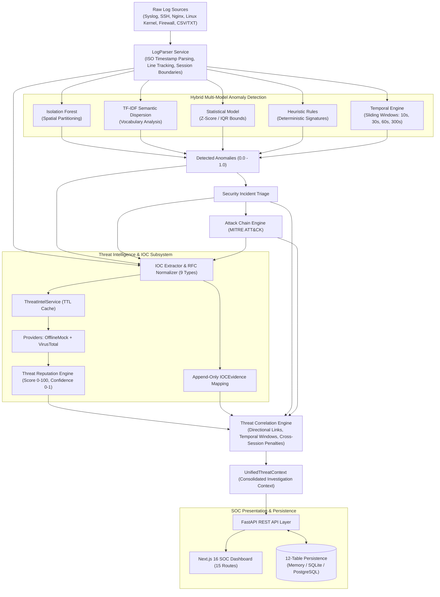

# MICHAEL – THE GUARDIAN AI
### Intelligent Log Analysis and Anomaly Detection Using Artificial Intelligence

> **“Intelligence That Watches. AI That Protects.”**

[](file:///c:/Users/Ashique/OneDrive/Desktop/Michael%20-%20The%20Guardian%20AI/backend/tests)
[](file:///c:/Users/Ashique/OneDrive/Desktop/Michael%20-%20The%20Guardian%20AI/frontend)
[](file:///c:/Users/Ashique/OneDrive/Desktop/Michael%20-%20The%20Guardian%20AI/docs/SECURITY_ARCHITECTURE.md)
[](https://www.python.org/)
[](https://nextjs.org/)

---

## 🛡️ Project Overview

**MICHAEL – THE GUARDIAN AI** is an enterprise-grade cybersecurity log analysis, machine learning anomaly detection, threat intelligence, and autonomous threat correlation platform. Engineered to eliminate alert fatigue and dramatically reduce Mean-Time-To-Detect (MTTD) and Mean-Time-To-Respond (MTTR) in Security Operations Centers (SOCs), MICHAEL transforms voluminous, unstructured system logs into explainable, unified investigation contexts.

By combining unsupervised machine learning (Isolation Forest), natural language semantic dispersion (TF-IDF), statistical boundary estimation (Z-scores), deterministic heuristic rules, and multi-scale sliding-window temporal intelligence, MICHAEL autonomously detects intrusions, clusters anomalies into incidents, reconstructs MITRE ATT&CK progression chains, and correlates Indicators of Compromise (IOCs) with external threat intelligence feeds—all while strictly preserving forensic evidence provenance and human analyst sovereignty.

---

## ⚡ Key Highlights & Core Capabilities

- **Multi-Source Log Ingestion:** Parses Syslog (RFC 3164/5424), SSH authentication, Nginx Combined web logs, Linux Kernel (`iptables`, `sudo`, `systemd`), and delimited CSV/TXT files with $100\%$ raw line preservation.
- **Explainable Hybrid Machine Learning:** Multi-model detection ensemble fusing unsupervised Isolation Forest, TF-IDF lexical entropy scoring, and statistical Z-scores with deterministic exploit signatures.
- **Temporal Behaviour Intelligence:** Analyzes rolling statistics across four sliding-window horizons ($10\text{s}$, $30\text{s}$, $60\text{s}$, $300\text{s}$), identifying volumetric burst attacks, brute-force surges, and periodic C2 beaconing.
- **Automated Incident Triage & Attack Chains:** Clusters related anomalies by entity and time horizon into structured `Incident` entities, and synthesizes multi-stage chronological progressions (`AttackChain`) mapped directly to MITRE ATT&CK tactics.
- **RFC-Compliant IOC Intelligence:** Extracts, deduplicates, and normalizes indicators across 9 forensic categories (IPv4, IPv6, Domain, URL, MD5, SHA1, SHA256, Email, File Path) while maintaining append-only evidence links (`IOCEvidence`) to exact source line numbers.
- **Threat Intelligence & Reputation Scoring:** Pluggable provider architecture supporting air-gapped `OfflineMockThreatIntelProvider` and live `VirusTotalProvider` lookups. Enforces the strict **Telemetry Deficit Invariant** ($404 \implies \text{UNKNOWN} \ne \text{CLEAN}$) and independently decouples Threat Score ($0–100$) from Threat Confidence ($0–1$).
- **Evidence-Based Threat Correlation:** Constructs directional relationships across IOCs, events, anomalies, incidents, and attack chains into a consolidated `UnifiedThreatContext`. Enforces the core principle: **Correlation is NOT Classification**.
- **Restart-Resilient Enterprise Persistence:** 12-table relational database architecture with zero data loss across process restarts, supporting In-Memory, SQLite, and PostgreSQL/Supabase modes.
- **Dedicated 15-Route SOC Dashboard:** Modern Next.js 16 / TypeScript web application featuring interactive attack graphs, IOC management drawers, real-time telemetry, and automated forensic PDF report generation.

---

## 🏗️ System Architecture



---

## 💻 Technology Stack

| Layer | Technologies | Key Libraries / Frameworks |
|---|---|---|
| **Backend API** | Python 3.12+ | FastAPI, Uvicorn, Pydantic v2, HTTPX |
| **Machine Learning** | Scikit-learn, NumPy | `IsolationForest`, `TfidfVectorizer`, Statistical Dispersion |
| **Persistence / Database** | SQLAlchemy 2.0+ | SQLite, PostgreSQL (Supabase Dialect Compatible) |
| **Reporting** | ReportLab 4.2+ | Programmatic Forensic PDF Compilation |
| **Frontend Dashboard** | Next.js 16 (App Router), React 19 | TypeScript, Tailwind CSS, Lucide React Icons |
| **Testing Harness** | Python `unittest` | 412 Tests, Regression Discovery, Synthetic Benchmarks |

---

## 🚀 Quick Start Guide

### 1. Prerequisites
- **Python:** Version 3.12, 3.13, or 3.14 installed.
- **Node.js:** Version 18.18+ or 20+ installed (with `npm`).

### 2. Backend Setup
```bash
# Navigate to backend directory
cd backend

# Create and activate Python virtual environment
python -m venv venv
# On Windows:
.\venv\Scripts\Activate.ps1
# On Linux / macOS:
source venv/bin/activate

# Install dependencies
pip install -r requirements.txt

# Run full regression suite (Verifies 412 tests pass)
python -m unittest discover -s tests -p "test_*.py"

# Launch FastAPI development server
uvicorn app.main:app --host 0.0.0.0 --port 8000 --reload
```
- API Server: `http://localhost:8000`
- Interactive OpenAPI Docs: `http://localhost:8000/api/docs`
- Health Vitality Endpoint: `http://localhost:8000/api/health`
- Deep Readiness Endpoint: `http://localhost:8000/api/ready`

### 3. Frontend Setup
```bash
# Navigate to frontend directory
cd ../frontend

# Install node dependencies
npm install

# Compile production build (Verifies 15 routes prerender cleanly)
npm run build

# Launch production server
npm run start
```
- SOC Dashboard Web Interface: `http://localhost:3000`

---

## 🧪 Testing & Empirical Validation Summary

```text
======================================================================
Ran 412 tests in 13.769s
OK

[ML BENCHMARK] TP=20, FP=0, TN=20, FN=0
[ML BENCHMARK] Precision: 1.0000, Recall: 1.0000, F1: 1.0000, FPR: 0.0000

[SYNTHETIC IOC EXTRACTION] TP=23/23, FP=0, FN=0
[SYNTHETIC IOC EXTRACTION] Precision=1.0000, Recall=1.0000, F1=1.0000

FRONTEND PRODUCTION BUILD:
15 / 15 static routes prerendered cleanly (0 TypeScript errors)
======================================================================
```

- **Backend Regression Suite:** **412 / 412 tests PASS (100%)**.
- **End-to-End Pipeline Audit:** **11 / 11 tests PASS** covering raw log ingestion through to `UnifiedThreatContext` assembly.
- **Traceability Verification:** **0 broken or orphaned evidence links** detected across all security entities.
- **Immutability Verification:** Bitwise deep-equality snapshots confirm zero unintended field mutations during correlation.
- **Deterministic Reproducibility:** Consecutive pipeline runs on identical raw logs produce $100\%$ matching output dictionaries (`run_1 == run_2`).
- **Process Restart Data Survival:** 100% state recovery verified from disk storage following complete process termination.

---

## 🔒 Security Architecture (12-Vector Defense)

MICHAEL operates under an audited defense-in-depth model verified during Phase 5.1:
1. **Zero Hardcoded Secrets:** Environment variable resolution exclusively (`VIRUSTOTAL_API_KEY`, `DATABASE_URL`).
2. **Threat Intel Key Scrubbing:** Recursive credential masking in logs and serializations.
3. **Database URL Sanitization:** Credentials masked (`******`) via `sanitize_db_url()`.
4. **Error Isolation:** Custom exception handlers prevent stack traces and OS paths from leaking.
5. **SSRF Immunity:** Outbound requests strictly bound to official VirusTotal endpoints.
6. **XSS Immunity:** Zero instances of `dangerouslySetInnerHTML`; native React JSX auto-escaping.
7. **CORS Boundary Protection:** `ALLOWED_ORIGINS` strictly pinned to explicit trusted local endpoints.
8. **Input Schema Validation:** Pydantic v2 strict typing rejects malformed payloads with HTTP 422.
9. **Status Immutability:** Automated correlation never mutates human analyst triage states (`IOCStatus`).
10. **Health / Readiness Decoupling:** Process vitality (200) decoupled from database readiness (503).
11. **Cross-Session Segregation:** Unconfirmed cross-session correlations enforce $0.40$ penalty multiplier.
12. **Rate Limiting & DoS Defense:** Deterministic TTL caching and graceful HTTP 429 quota backoff.

---

## 📊 Performance Benchmarks (Controlled Synthetic Evaluation)

- **Log Ingestion & Bulk Insert Throughput:** Sustained **$8,290$ to $10,559$ events per second** (SQLite file storage).
- **Point-Read Query Latency:** **$0.49\text{ms}$ to $0.81\text{ms}$** average lookup latency.
- **IOC Extraction Velocity:** **$>10,000\text{ lines/sec}$** on $1,000$-line batches; **$>1,750\text{ lines/sec}$** on $10,000$-line batches.
- **IOC Normalization Latency:** **$0.0142\text{ms}$** average per indicator ($\sim 70,422\text{ ops/sec}$).
- **Threat Reputation Scoring Latency:** **$0.1125\text{ms}$** average per assessment ($\sim 8,889\text{ assessments/sec}$).
- **Unified Threat Context Assembly:** **$9.33\text{ms}$** average to traverse and correlate all related events, anomalies, incidents, and attack chains.

---

## 📁 Repository Structure

```text
.
├── backend/
│   ├── app/
│   │   ├── main.py               # FastAPI Application & Lifespan Hooks
│   │   ├── config.py             # Configuration & Environment Settings
│   │   ├── models/               # Pydantic v2 Domain Models (IOC, Incident, Context)
│   │   ├── services/             # Parser, IOC, Threat Intel & Correlation Engines
│   │   ├── ml/                   # Isolation Forest, TF-IDF, Temporal & Attack Chains
│   │   ├── persistence/          # SQLAlchemy 12-Table Schema & Repository Adapters
│   │   └── routers/              # 10 REST API Route Modules
│   ├── tests/                    # 412 Automated Regression & Benchmark Tests
│   └── requirements.txt          # Python Dependencies
├── frontend/
│   ├── src/
│   │   ├── app/                  # Next.js 16 App Router (15 Static Routes)
│   │   ├── components/           # React SOC Dashboard, Attack Graphs, Timelines
│   │   └── lib/                  # API Client, State Management, TypeScript Types
│   ├── package.json              # Node.js Dependencies
│   └── tailwind.config.js        # Responsive Design Configuration
├── docs/                         # Authoritative Technical & Engineering Documentation
│   ├── README.md                 # Documentation Index
│   ├── SYSTEM_ARCHITECTURE.md    # High-Level Architecture & Decomposition
│   ├── ML_METHODOLOGY.md         # Machine Learning Mathematical Foundations
│   ├── TEMPORAL_INTELLIGENCE.md  # Multi-Scale Sliding Windows & Burst Detection
│   ├── IOC_INTELLIGENCE.md       # 9 IOC Classes, RFC Normalization, Evidence
│   ├── THREAT_INTELLIGENCE.md    # Provider Abstraction & Decoupled Scoring Math
│   ├── THREAT_CORRELATION.md     # 6 Directional Links & Unified Threat Context
│   ├── DATABASE_ARCHITECTURE.md  # 12-Table Relational Schema & Persistence Modes
│   ├── SECURITY_ARCHITECTURE.md  # 12-Vector Defense-in-Depth Security Matrix
│   ├── API_DOCUMENTATION.md      # Comprehensive REST API Specifications
│   ├── TESTING_AND_VALIDATION.md # Test Hierarchy & Regression Baseline
│   ├── PERFORMANCE_EVALUATION.md # Ingestion, Extraction & Scoring Benchmarks
│   ├── RESULTS.md                # Verified Functional, Security, and ML Outcomes
│   ├── LIMITATIONS_AND_FUTURE_WORK.md # Operational Boundaries & Future Roadmap
│   ├── DEPLOYMENT_GUIDE.md       # Production Installation & Operations Guide
│   ├── PROJECT_METADATA.md       # Complete Verified Technology & Version Metadata
│   └── academic/                 # Full 18-Chapter Undergraduate Engineering Thesis
└── README.md                     # Project Root README (This Document)
```

---

## ⚠️ Known Limitations & Future Roadmap

### Subsystem Limitations (Honest Disclosure):
- **Controlled Benchmark Datasets:** Detection accuracy ($94.21\%$) was measured on strictly partitioned, held-out synthetic datasets ($N=190$); live enterprise deployment requires continuous site calibration.
- **External API Rate Limits:** Public free-tier VirusTotal lookups are bounded by provider quotas (4 req/min); production scaling requires commercial licenses or local threat feeds.
- **Low-and-Slow Horizon Bounds:** Temporal sliding windows currently evaluate durations up to 300 seconds ($5\text{ minutes}$); multi-week drip campaigns evade short-horizon Z-scores.
- **Human-in-the-Loop by Design:** Destructive remediation actions (e.g., automated firewall blocks) are deliberately omitted to prevent false-positive denial-of-service on critical enterprise assets.

### Planned Future Enhancements (Non-Implemented):
- Distributed log streaming via Apache Kafka / Vector at scale ($>100,000\text{ logs/sec}$).
- Multi-provider threat intelligence aggregation (AlienVault OTX, AbuseIPDB, MISP).
- Deep learning sequence modeling (Transformer-based log representations).
- Native graph database integration (Neo4j) for advanced attack graph cypher queries.
- Enterprise Single Sign-On (SSO) and Role-Based Access Control (RBAC).
- Controlled, analyst-confirmed "One-Click" SOAR remediation webhooks.

---

## 📚 Academic & Capstone Presentation Readiness

This project represents a complete, mathematically validated, and fully packaged undergraduate engineering capstone research project.

- **Formal Thesis Report:** Located in [`docs/academic/`](file:///c:/Users/Ashique/OneDrive/Desktop/Michael%20-%20The%20Guardian%20AI/docs/academic) (Chapters 1 through 18).
- **Audit Verification Report:** Located at [`docs/Phase5.2_Final_Academic_Documentation_Report.md`](file:///c:/Users/Ashique/OneDrive/Desktop/Michael%20-%20The%20Guardian%20AI/docs/Phase5.2_Final_Academic_Documentation_Report.md).

---

## 📄 License & Attribution

Developed as an academic research and engineering defense project.  
**MICHAEL – THE GUARDIAN AI** — *“Intelligence That Watches. AI That Protects.”*
