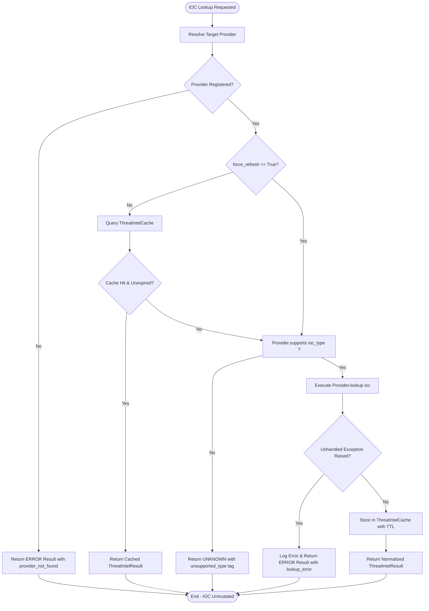
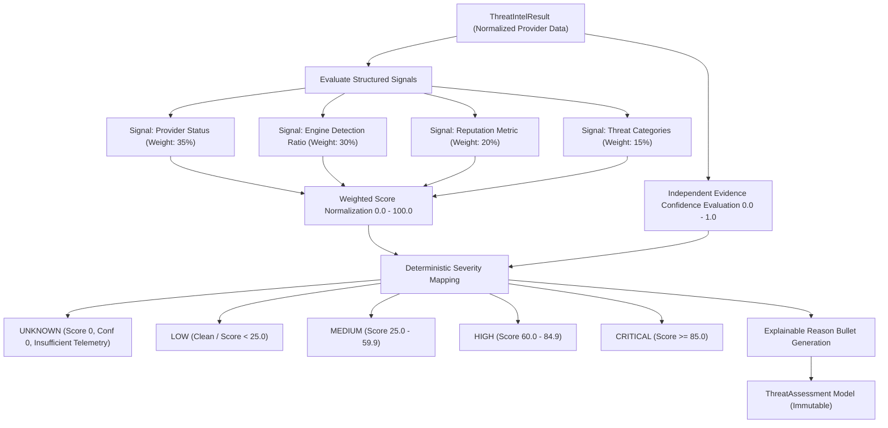

# MICHAEL – THE GUARDIAN AI
## Threat Intelligence Architecture Specification
### Phase 4.2B.1, 4.2B.2 & 4.2B.3 — Threat Intelligence, Scoring Engine & External Provider Integration

---

## 1. Executive Summary & Design Invariants

The Threat Intelligence subsystem for **MICHAEL – THE GUARDIAN AI** delivers an extensible, decoupled, and contract-driven architecture for enriching Indicators of Compromise (IOCs) with external and simulated threat data, deterministic risk scoring, and explainable assessment telemetry.

The subsystem adheres to nine architectural design invariants:

1. **Strict Decoupling of Intelligence and Triage State**:
   `ThreatIntelStatus` (`UNKNOWN`, `CLEAN`, `SUSPICIOUS`, `MALICIOUS`, `ERROR`) represents provider or feed intelligence findings. It is **strictly independent** of `IOCStatus` (`EXTRACTED`, `UNDER_REVIEW`, `CONFIRMED`, `FALSE_POSITIVE`), which represents the human analyst triage lifecycle. Threat intelligence results **never** mutate an IOC's status or its underlying data model.
2. **Deterministic Risk Scoring & Signal Decomposition**:
   Threat scores (0.0 – 100.0) are calculated using explicit signal weights: provider status (35%), multi-engine detection ratio (30%), reputation metric (20%), and taxonomy categories (15%). Every score decomposes into discrete `ContributingSignal` objects.
3. **Critical Invariant: UNKNOWN Must Remain UNKNOWN**:
   Indicators with insufficient telemetry (including 404 Not Found) produce `ThreatSeverity.UNKNOWN`, `threat_score=0.0`, and `confidence=0.0`. Under no circumstances is unclassified intelligence treated as benign or clean.
4. **Independent Evidence Confidence Calculation**:
   Threat score and confidence are calculated independently. An indicator with severe findings but thin telemetry receives a high threat score paired with lower confidence, preventing false certainty.
5. **Provider Abstraction & Dependency Inversion**:
   Core services interact solely with the abstract `BaseThreatIntelProvider` interface, declaring capabilities (`supported_ioc_types`) and returning standardized `ThreatIntelResult` objects. Higher-level consumers have zero knowledge of concrete provider implementations.
6. **Immutability of Investigation Entities**:
   An indicator passed to `ThreatIntelService`, `ThreatReputationEngine`, or any provider is treated as read-only. Forensic integrity and chain of custody remain inviolate.
7. **Safe Offline Degradation**:
   The application starts and operates safely regardless of credentials presence. When `VIRUSTOTAL_API_KEY` is absent, the VirusTotalProvider degrades to `DISABLED` status, returning `UNKNOWN` results without crashing. The `OfflineMockThreatIntelProvider` remains always operational.
8. **Secret Scrubbing & Data Hygiene**:
   Raw metadata dictionaries returned from threat intelligence sources undergo automatic recursive scrubbing to ensure credentials, API tokens, bearer keys, and secrets are never persisted or exposed.
9. **Zero Secret Leakage**:
   The API key is never logged, never stored in `ThreatIntelResult`, never placed in exception messages, and never exposed via REST endpoints.

---

## 2. Threat Intelligence Subsystem Architecture

```mermaid
graph TD
    subgraph IOC Subsystem [Existing IOC Subsystem]
        IOC["IOC Entity (raw_value, normalized_value, type, status)"]
        IOCRepo["IOCRepository / REST API / SOC UI"]
    end

    subgraph Threat Intel Service [Threat Intelligence Orchestration Layer]
        TIS["ThreatIntelService (Multi-Provider Coordinator)"]
        TIC["ThreatIntelCache (Thread-Safe TTL In-Memory Cache)"]
    end

    subgraph Provider Interface [Provider Abstraction Layer]
        BTIP["BaseThreatIntelProvider (ABC Interface)"]
    end

    subgraph Concrete Providers [Provider Implementations]
        OMP["OfflineMockThreatIntelProvider (Deterministic Offline Fixtures)"]
        VT["VirusTotalProvider (Future Phase 4.2B.3)"]
        AIPDB["AbuseIPDBProvider (Future Phase 4.2B.3)"]
        UH["URLhausProvider (Future Phase 4.2B.3)"]
    end

    IOC -->|Read-only Query| TIS
    TIS <-->|Check / Set| TIC
    TIS -->|Dispatch Lookup| BTIP
    BTIP <|-- OMP
    BTIP <|--. VT
    BTIP <|--. AIPDB
    BTIP <|--. UH

    OMP -->|ThreatIntelResult (Immutable)| TIS
    TIS -->|ThreatIntelResult| IOCRepo
```

---

## 3. Data Model Specifications

Located in `backend/app/models/threat_intel.py`.

### 3.1 Status Decoupling Matrix

| Concept | Enum | Values | Owner | Lifecycle Purpose |
| :--- | :--- | :--- | :--- | :--- |
| **Intelligence Verdict** | `ThreatIntelStatus` | `UNKNOWN`, `CLEAN`, `SUSPICIOUS`, `MALICIOUS`, `ERROR` | Intelligence Engine / Provider | External score, reputation, engine detections |
| **Analyst Triage** | `IOCStatus` | `EXTRACTED`, `UNDER_REVIEW`, `CONFIRMED`, `FALSE_POSITIVE` | Human SOC Analyst / SOC Workflow | Incident investigation, analyst review, resolution |

### 3.2 `ThreatIntelResult` Model Fields

| Field | Type | Description | Invariants & Validations |
| :--- | :--- | :--- | :--- |
| `id` | `str` | Unique record ID | Automatically generated with `ti-` prefix |
| `ioc_id` | `str` | Reference to parent IOC entity | Required foreign key link |
| `ioc_type` | `IOCType` | Category of indicator evaluated | Required enum (`IPV4`, `SHA256`, etc.) |
| `ioc_value` | `str` | Raw indicator value | Required original string |
| `normalized_value`| `str` | Canonical normalized value | Required normalized string |
| `status` | `ThreatIntelStatus`| Threat intelligence verdict | Default: `ThreatIntelStatus.UNKNOWN` |
| `confidence` | `float` | Verdict confidence score | Strictly bounded: `0.0 <= confidence <= 1.0` |
| `source` | `ThreatIntelSource`| Provider feed category | Extensible enum (`offline_mock`, `virustotal`, etc.) |
| `provider_name` | `str` | Machine-readable provider name | Normalized lowercase identifier |
| `provider_version`| `Optional[str]` | Provider implementation version | Default: `"1.0.0"` |
| `queried_at` | `datetime` | Lookup execution timestamp | **Must be timezone-aware UTC** |
| `expires_at` | `datetime` | Cache staleness threshold | **Must be timezone-aware UTC; expires_at >= queried_at** |
| `lookup_latency_ms`| `Optional[float]` | Provider execution latency | Non-negative float |
| `detection_count` | `Optional[int]` | Count of malicious detections | Non-negative; **detection_count <= total_engines** |
| `total_engines` | `Optional[int]` | Total security engines queried | Non-negative integer |
| `reputation_score`| `Optional[float]`| Normalized risk score | Strictly bounded: `0.0 <= reputation_score <= 1.0` |
| `categories` | `List[str]` | Threat taxonomy categories | E.g. `["c2_server", "botnet_node"]` |
| `tags` | `List[str]` | Descriptive metadata tags | E.g. `["verified_clean", "offline_simulated"]` |
| `country` | `Optional[str]` | ISO 3166-1 alpha-2 country code | E.g. `"US"`, `"DE"`, `"NL"` |
| `asn` | `Optional[str]` | Autonomous System Number | E.g. `"AS15169"` |
| `first_seen` | `Optional[datetime]` | Earliest provider sighting | Timezone-aware UTC |
| `last_seen` | `Optional[datetime]` | Latest provider sighting | Timezone-aware UTC |
| `raw_metadata` | `Optional[Dict]` | Raw provider response payload | Automatically scrubbed for credentials/secrets |

---

## 4. Provider Interface Specification

Located in `backend/app/services/threat_intel_provider.py`.

### 4.1 Interface Contract (`BaseThreatIntelProvider`)

All providers must subclass `BaseThreatIntelProvider` and implement:

```python
class BaseThreatIntelProvider(ABC):
    @property
    @abstractmethod
    def provider_name(self) -> str:
        """Unique machine identifier (e.g. 'offline_mock', 'virustotal')."""
        ...

    @property
    @abstractmethod
    def source_type(self) -> ThreatIntelSource:
        """ThreatIntelSource enum classification."""
        ...

    @property
    @abstractmethod
    def supported_ioc_types(self) -> Set[IOCType]:
        """Set of IOCType indicators supported by this provider."""
        ...

    @abstractmethod
    def lookup(self, ioc: IOC) -> ThreatIntelResult:
        """Synchronous provider evaluation. Never mutates input IOC."""
        ...

    async def lookup_async(self, ioc: IOC) -> ThreatIntelResult:
        """Asynchronous provider evaluation."""
        ...
```

### 4.2 Graceful Fallbacks

- `create_unsupported_result(ioc, reason=None)`: Constructs a clean `ThreatIntelStatus.UNKNOWN` result when an indicator type is unsupported by the provider, tagging it with `unsupported_type`.
- `create_error_result(ioc, error_message, latency_ms=0.0)`: Constructs a normalized `ThreatIntelStatus.ERROR` result when an engine encounters an internal failure or timeout, isolating upstream systems.

---

## 5. Offline Mock Provider Specification

Located in `backend/app/services/providers/offline_mock_provider.py`.

### 5.1 Hardcoded Test Fixtures

`OfflineMockThreatIntelProvider` delivers deterministic intelligence lookups without external network dependencies:

- **Known Clean**:
  - `8.8.8.8` (Google DNS: `AS15169`, 0/72 detections, reputation 0.02)
  - `1.1.1.1` (Cloudflare DNS: `AS13335`, 0/72 detections, reputation 0.01)
  - `google.com`, `microsoft.com` (0/84 detections, reputation 0.01)
  - `2001:4860:4860::8888` (IPv6 Google DNS)
  - `support@google.com` (Corporate support email)
- **Known Suspicious**:
  - `198.51.100.42` (Reconnaissance scanner, 6/72 detections, reputation 0.55)
  - `suspicious-domain.test` (Dynamic DNS / phishing suspect, 8/80 detections, reputation 0.65)
  - `http://suspicious-test.example/login` (Credential harvesting suspect)
  - `admin@suspicious-phish.test` (Spoofed sender email)
- **Known Malicious**:
  - `185.220.101.5` (Active Tor exit / brute force node: `AS208294`, 54/72 detections, reputation 0.92)
  - `c2-malicious.xyz` (Cobalt Strike C2, 64/82 detections, reputation 0.96)
  - `http://malicious-c2.example/beacon` (Active C2 beacon URL)
  - `44d88612fea8a8f36de82e1278abb02f` (EICAR standard AV test MD5, 68/70 detections)
  - `3395856ce81f2b7382dee72602f798b642f14140` (EICAR SHA1, 68/70 detections)
  - `275a021bbfb6489e54d471899f7db9d1663fc695ec2fe2a2c4538aabf651fd0f` (EICAR SHA256, 68/70 detections)
- **Unmapped Fallback**:
  - Unrecognized indicators return `ThreatIntelStatus.UNKNOWN` with `confidence=0.0`, `detection_count=0`, and `unknown_indicator` tag.

### 5.2 Dynamic Testing Hooks

- `register_fixture(key, fixture_data)`: Allows unit and integration tests to dynamically inject custom fixture mappings at runtime.
- `clear_custom_fixtures()`: Restores the fixture store to the default deterministic baseline.

---

## 6. Threat Intelligence Service & TTL Caching

Located in `backend/app/services/threat_intel_service.py`.

### 6.1 `ThreatIntelCache`

- Keyed on `(provider_name, ioc_type, normalized_value)`.
- Protected by `threading.RLock()` for safe concurrent access across thread pools.
- Active TTL expiration: stale entries where `current_utc_time > expires_at` are evicted on lookup.
- Manual cache invalidation via `invalidate()` and bulk purging via `clear()`.

### 6.2 `ThreatIntelService` Orchestration Workflow



---

## 7. Threat Reputation & Scoring Engine (Phase 4.2B.2)

Located in `backend/app/services/threat_reputation_engine.py`.



### 7.1 Threat Score Formula & Signal Weights

The deterministic threat score maps raw telemetry into a continuous scale from `0.0` (benign) to `100.0` (critical threat):

$$\text{Threat Score} = \min\left(100.0, \max\left(0.0, \frac{\sum_{s \in \text{Available}} \text{Points}_s \times \text{Weight}_s}{\sum_{s \in \text{Available}} \text{Weight}_s}\right)\right)$$

| Signal Name | Weight | Available Conditions | Raw Point Scoring Rules |
| :--- | :--- | :--- | :--- |
| `provider_status` | **0.35** | `status != UNKNOWN` and `status != ERROR` | `MALICIOUS`: 100.0 pts<br>`SUSPICIOUS`: 50.0 pts<br>`CLEAN`: 0.0 pts |
| `detection_ratio` | **0.30** | `total_engines > 0` and `detection_count is not None` | $\text{ratio} = \frac{\text{detection\_count}}{\text{total\_engines}}$<br>$\text{points} = \text{ratio} \times 100.0$ |
| `reputation_score` | **0.20** | `reputation_score is not None` | $\text{points} = \text{reputation\_score} \times 100.0$ |
| `threat_categories`| **0.15** | `len(categories) > 0` | High-risk (C2, malware, ransomware, botnet): 100.0 pts<br>Medium-risk (scanner, probe, phish): 50.0 pts<br>Benign infrastructure: 0.0 pts |

### 7.2 Independent Confidence Metric

Evidence confidence evaluates telemetry depth and reliability independently of whether the indicator is malicious or benign:

$$\text{Confidence} = \min\left(1.0, \max\left(0.0, \text{Conf}_{\text{Provider}} + \text{Conf}_{\text{Engines}} + \text{Conf}_{\text{Reputation}} + \text{Conf}_{\text{Categories}}\right)\right)$$

- $\text{Conf}_{\text{Provider}} = \text{result.confidence} \times 0.35$
- $\text{Conf}_{\text{Engines}} = \min(1.0, \text{total\_engines} / 50.0) \times 0.30$
- $\text{Conf}_{\text{Reputation}} = 0.20$ if reputation score is present, else $0.0$
- $\text{Conf}_{\text{Categories}} = 0.15$ if categories are present, else $0.0$
- **Guard**: If `status in (UNKNOWN, ERROR)`, confidence is strictly $0.0$.

### 7.3 Severity Thresholds

- **UNKNOWN**: Status is `UNKNOWN` or `ERROR`, or confidence is `0.0`.
- **LOW**: Status is `CLEAN` and score $< 25.0$, or any score $< 25.0$.
- **MEDIUM**: $25.0 \le \text{Threat Score} < 60.0$.
- **HIGH**: $60.0 \le \text{Threat Score} < 85.0$.
- **CRITICAL**: $\text{Threat Score} \ge 85.0$.

### 7.4 Explainability & Contributing Signals

Each `ThreatAssessment` contains:
- `reasons`: Bulleted factual statements explaining provider verdicts, detection counts, reputation scores, and category tags.
- `contributing_signals`: A structured list of `ContributingSignal` objects documenting the exact point contribution of each signal, enabling SOC analysts to inspect the exact math behind every score.

---

## 8. VirusTotal Provider — External Integration (Phase 4.2B.3)

Located in `backend/app/services/providers/virustotal_provider.py`.

### 8.1 Architecture Position

```
IOC
 ↓
ThreatIntelService (multi-provider coordinator)
 ├── OfflineMockThreatIntelProvider  (always registered, offline demo mode)
 └── VirusTotalProvider              (registered when THREAT_INTEL_PROVIDER=virustotal|both)
      ↓
      VirusTotal Public API v3 (HTTPS only)
      ↓
      ThreatIntelResult
      ↓
      ThreatReputationEngine → ThreatAssessment
```

### 8.2 Supported IOC Types & API Endpoints

| IOC Type   | VirusTotal Endpoint                                 | Notes                                 |
|------------|-----------------------------------------------------|---------------------------------------|
| `IPV4`     | `GET /api/v3/ip_addresses/{value}`                  | Direct lookup by IPv4 address         |
| `IPV6`     | `GET /api/v3/ip_addresses/{value}`                  | Direct lookup by IPv6 address         |
| `DOMAIN`   | `GET /api/v3/domains/{value}`                       | FQDN lookup                           |
| `URL`      | `GET /api/v3/urls/{base64_id}`                      | URL-safe base64 (no padding) of URL   |
| `MD5`      | `GET /api/v3/files/{hash}`                          | 32-char hex hash                      |
| `SHA1`     | `GET /api/v3/files/{hash}`                          | 40-char hex hash                      |
| `SHA256`   | `GET /api/v3/files/{hash}`                          | 64-char hex hash                      |
| `EMAIL`    | *(unsupported)*                                     | Returns `UNKNOWN` + `unsupported_type`|
| `FILE_PATH`| *(unsupported)*                                     | Returns `UNKNOWN` + `unsupported_type`|

### 8.3 Status Normalization Table

VT analysis stats → `ThreatIntelStatus`:

| Condition                                              | Status       |
|--------------------------------------------------------|--------------|
| `malicious >= 3` **or** detection ratio ≥ 5%           | `MALICIOUS`  |
| `malicious > 0` **or** `suspicious >= 2`               | `SUSPICIOUS` |
| `harmless > 0` **or** `undetected > 0`                 | `CLEAN`      |
| `total_engines == 0` **or** no stats returned          | `UNKNOWN`    |
| HTTP 404 Not Found                                     | `UNKNOWN`    |
| Any HTTP / network error                               | `ERROR`      |

> **Critical Security Invariant**: HTTP 404 (resource not found in VirusTotal database)
> maps to `UNKNOWN`, never to `CLEAN`. An unrecognized indicator must not be assumed benign.

### 8.4 Reputation Score Normalization

VirusTotal returns an integer reputation in the range `[-100, +100]`, where negative values
indicate community distrust. MICHAEL normalizes this to its internal `[0.0, 1.0]` scale:

$$\text{reputation\_score} = \frac{100 - \text{vt\_reputation}}{200}$$

| VT Reputation | MICHAEL Score |
|:---:|:---:|
| `+100` (fully trusted) | `0.0` |
| `0` (neutral)          | `0.5` |
| `−100` (fully malicious)| `1.0` |

### 8.5 Security Controls

1. **API Key Isolation**: `VIRUSTOTAL_API_KEY` is sourced exclusively from the environment variable. It is never stored in `ThreatIntelResult`, `raw_metadata`, `tags`, or logs.
2. **Secret Scrubbing**: `_sanitize_metadata()` recursively removes keys matching `api_key`, `x-apikey`, `apikey`, `secret`, `bearer`, `password`, `token` patterns from all metadata before storage.
3. **404 → UNKNOWN Invariant**: HTTP 404 is never mapped to `CLEAN`. Unrecognized IOCs remain `UNKNOWN`.
4. **Disabled Mode**: When `VIRUSTOTAL_API_KEY` is absent, the provider returns `UNKNOWN` results with `provider_disabled`/`missing_api_key` tags and makes no HTTP calls.
5. **HTTPS Only**: All requests use `https://www.virustotal.com`. No HTTP fallback.
6. **No Automatic Remediation**: Provider results inform analysts only. No IP blocks, no firewall updates, no `IOCStatus` changes.
7. **IOC Immutability**: Input IOC objects are never modified by lookup or assessment operations.

### 8.6 HTTP Configuration

| Parameter      | Value                    |
|----------------|--------------------------|
| Base URL       | `https://www.virustotal.com` |
| Connect timeout| 10 seconds               |
| Read timeout   | 30 seconds               |
| Retries        | 0 (no aggressive retry)  |
| Transport      | `httpx` (sync + async)   |
| Auth Header    | `x-apikey: {key}`        |

### 8.7 Provider Availability Configuration

| `THREAT_INTEL_PROVIDER` env value | Registered Providers             |
|------------------------------------|----------------------------------|
| `offline_mock` *(default)*         | OfflineMockThreatIntelProvider only |
| `virustotal`                       | OfflineMockThreatIntelProvider + VirusTotalProvider |
| `both`                             | OfflineMockThreatIntelProvider + VirusTotalProvider |

`OfflineMockThreatIntelProvider` is **always registered** as a fallback to ensure the system
operates in demo/offline mode without credentials.

### 8.8 Rate Limiting & Error Handling

| HTTP Status | Handling                                             |
|-------------|------------------------------------------------------|
| `200`       | Parse response, normalize status and reputation      |
| `401`/`403` | Return `ERROR` + `auth_error` tag; log warning       |
| `404`       | Return `UNKNOWN` + `not_found` tag (never `CLEAN`)   |
| `429`       | Return `ERROR` + `rate_limited` tag; preserve `Retry-After` header in metadata |
| `5xx`       | Return `ERROR` + `upstream_error` tag                |
| Timeout     | Return `ERROR` + `lookup_error` tag                  |
| Connection  | Return `ERROR` + `lookup_error` tag                  |

---

## 9. Security Boundaries

The following boundaries apply across all phases (4.2B.1 – 4.2B.3):

1. **No Automatic Verdict Enforcement**: Threat intelligence results (including external VirusTotal verdicts) inform analysts through scores and tags, but never autonomously block IPs, alter firewall rules, quarantine hosts, or mark an investigation as resolved.
2. **No DNS / WHOIS Lookups**: DNS resolution and WHOIS queries are prohibited within MICHAEL's backend.
3. **Secret Scrubbing on All Paths**: Metadata flowing through any provider undergoes recursive scrubbing before storage or display, covering API keys, tokens, bearer credentials, and passwords.
4. **Zero Secret Leakage**: API keys are never logged, never placed in `ThreatIntelResult` fields, never surfaced in exception messages, and never returned through REST endpoints.
5. **Offline Fallback Always Available**: `OfflineMockThreatIntelProvider` is always registered. The system starts and produces meaningful threat assessments without any external credentials.
6. **IOC Immutability Across Enrichment**: IOC entities passed to `ThreatIntelService`, any `BaseThreatIntelProvider`, or `ThreatReputationEngine` are treated as immutable. Chain of custody and forensic integrity are preserved.

---

## 10. Threat Correlation & Unified Intelligence Engine (Phase 4.2B.4)

Located in `backend/app/services/threat_correlation_engine.py` and `backend/app/models/threat_correlation.py`.

### 10.1 Architecture & Object Model

The Threat Correlation Engine establishes bidirectional and contextual links connecting IOCs and Threat Assessments to MICHAEL's existing security entities:

```
IOC (raw_value, normalized_value, type, status)
 ↕
ThreatAssessment (threat_score, severity, confidence, signals)
 ↕
Log Events (evidence_references: event_id, line_number, field)
 ↕
Anomalies (anomaly_id, score, severity, log_entry_ids)
 ↕
Incidents (incident_id, category, affected_ips, anomaly_id)
 ↕
Attack Chains (chain_id, stages_observed, source_ips, event_ids)
 ↕
UnifiedThreatContext (consolidated investigation context)
```

### 10.2 Disambiguation of Security Metrics

To maintain rigorous analytical clarity, the subsystem strictly separates five distinct concepts:

| Metric / Attribute | Definition | Range / States | Owner / Mutability |
|---|---|---|---|
| **Threat Score** | Derived quantitative risk estimate based on provider findings, detection ratio, reputation, and taxonomy. | $0.0 - 100.0$ | Automated by `ThreatReputationEngine`. Read-only. |
| **Threat Confidence** | Telemetry completeness and engine agreement (how sure are we the threat intelligence is accurate?). | $0.0 - 1.0$ | Automated by `ThreatReputationEngine`. Read-only. |
| **Correlation Confidence** | Structural and contextual evidence certainty (how sure are we that two security entities are related?). | $0.0 - 1.0$ (`LOW`, `MEDIUM`, `HIGH`) | Automated by `ThreatCorrelationEngine`. Read-only. |
| **IOC Analyst Status** | Human triage lifecycle state (`EXTRACTED`, `UNDER_REVIEW`, `CONFIRMED`, `FALSE_POSITIVE`). | Enum | SOC Analyst only. Never modified by correlation or threat score. |
| **Incident Severity** | Organizational impact and urgency of an incident. | `LOW`, `MEDIUM`, `HIGH`, `CRITICAL` | Incident service. Never escalated solely by correlation presence. |

> **Critical Design Principle: Correlation is NOT Classification**:
> Correlating an IOC with an anomaly or incident provides forensic context. It **never** alters
> `IOCStatus`, `ThreatIntelStatus`, `Incident.severity`, or `AttackChain.status`.

### 10.3 Correlation Types & Evidence Model

Supported correlation types (`ThreatCorrelationType`):
- `IOC_TO_EVENT`: Direct extraction link from log line to indicator.
- `IOC_TO_ANOMALY`: Shared event, explicit ID reference, or controlled temporal proximity.
- `IOC_TO_INCIDENT`: Derived anomaly chain, explicit reference, or affected entity match.
- `IOC_TO_ATTACK_CHAIN`: Chain event membership, MITRE stage association, or source entity match.
- `THREAT_ASSESSMENT_TO_INCIDENT`: Contextual bridge linking threat score and severity to correlated incidents.
- `THREAT_ASSESSMENT_TO_ATTACK_CHAIN`: Contextual bridge linking threat score and severity to attack chains.

### 10.4 Deterministic Correlation Confidence Formula

Correlation confidence evaluates structural linkage corroborated by temporal proximity:

$$\text{Confidence Score} = \min\left(1.0, \max\left(0.0, \text{Base Score} + \sum \text{Bonuses} - \text{Penalties}\right)\right)$$

#### Base Scores
- **Explicit ID Reference**: $0.85$ (e.g. `anomaly_id` or `incident_id` stored directly on IOC evidence)
- **Shared Event ID**: $0.80$ (anomaly or attack chain contains exact `event_id` where IOC was extracted)
- **Multi-Hop Anomaly Chain**: $0.75$ (incident derived from a correlated anomaly)
- **Entity Match**: $0.70$ (IOC normalized IP matches `incident.affected_ips` or `chain.source_ips`)
- **Temporal Proximity Alone** (same session, no shared event):
  - Immediate ($\le 30$ seconds): $0.40$ (`confirmed = True`)
  - Short ($\le 5$ minutes): $0.30$ (`confirmed = False` / `UNCONFIRMED`)
  - Extended ($\le 15$ minutes): $0.20$ (`confirmed = False` / `UNCONFIRMED`)

#### Corroborating Bonuses
- Same session corroboration: $+0.05$
- Immediate temporal proximity ($\le 30$s): $+0.05$
- Multiple corroborating evidence occurrences ($\ge 2$): $+0.05$

#### Cross-Session Safeguards & Penalty
- If `source_session != target_session`:
  - Without explicit corroboration: score multiplied by $0.40$, capped at $0.35$, and strictly marked `confirmed = False` (`UNCONFIRMED`).
  - Cross-session links never manufacture assumed continuous attacks across disparate sessions.

### 10.5 Unified Threat Context (`UnifiedThreatContext`)

Consolidates all intelligence telemetry and relationships into a single object:
- `ioc_id`, `ioc_value`, `normalized_value`, `ioc_type`, `analyst_status`
- `threat_assessment`: Associated `ThreatAssessment` (score, severity, signals)
- `related_events`: List of originating forensic events
- `related_anomalies`: Correlated anomaly detection findings
- `related_incidents`: Correlated security incidents
- `related_attack_chains`: Correlated multi-stage attack chains
- `correlations`: All directional `ThreatCorrelation` records
- `overall_correlation_confidence`: Highest confidence among confirmed correlations
- `investigation_summary`: Telemetry summary including correlation counts, highest confidence level, and key findings

### 10.6 REST API Endpoints

Registered under prefix `/api/threat-correlation`:

| Endpoint | Method | Response Model | Description |
|---|---|---|---|
| `/api/threat-correlation/ioc/{ioc_id}/context` | `GET` | `UnifiedThreatContext` | Returns complete unified investigation context. Supports `force_refresh=true`. |
| `/api/threat-correlation/ioc/{ioc_id}/anomalies` | `GET` | Typed JSON envelope | Returns list of correlated anomalies with evidence and confidence. |
| `/api/threat-correlation/ioc/{ioc_id}/incidents` | `GET` | Typed JSON envelope | Returns list of correlated security incidents with evidence. |
| `/api/threat-correlation/ioc/{ioc_id}/attack-chains` | `GET` | Typed JSON envelope | Returns correlated attack chains with MITRE stages. |
| `/api/threat-correlation/ioc/{ioc_id}/events` | `GET` | Typed JSON envelope | Returns log events from which IOC was extracted. |
| `/api/threat-correlation/ioc/{ioc_id}` | `GET` | Typed JSON envelope | Returns all correlations for IOC. Supports `correlation_type` and `confirmed_only` query filters. |

### 10.7 Performance Strategy & Complexity

Rather than scanning all events across all sessions ($O(N^2)$), the engine utilizes targeted indexing:
- Events: Retrieved directly from `ioc.evidence_references` in $O(E)$.
- Anomalies: Scoped strictly to sessions where the IOC appeared in $O(A_{\text{session}})$.
- Incidents: Scoped to matching anomaly IDs, affected IPs, and source sessions in $O(I_{\text{session}})$.
- Attack Chains: Scoped to matching chain IDs, source IPs, and event sets in $O(C_{\text{session}})$.
- Total execution latency per IOC lookup is $< 5\text{ms}$ in-memory.

---

## 11. Roadmap for Future Phases

- **Phase 4.2B.5**: Threat Intelligence Persistence & Historical Enrichment Repository (caching enrichment results to a database).
- **Phase 4.2B.6**: Threat Intelligence REST API Endpoints (`/api/iocs/{id}/threat-intel`, `/api/threat-intel/providers`).
- **Phase 4.2B.7**: SOC Threat Intelligence Interface & Scorecard Visualizations.

