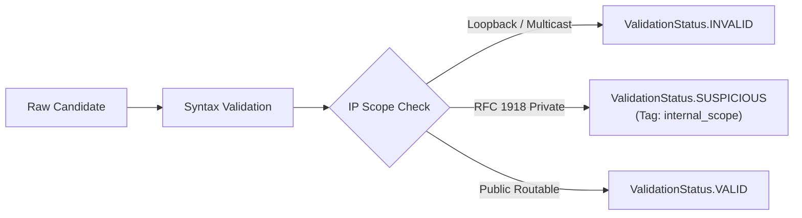

# INDICATOR OF COMPROMISE (IOC) INTELLIGENCE

**Project:** MICHAEL – THE GUARDIAN AI  
**Academic Title:** Intelligent Log Analysis and Anomaly Detection Using Artificial Intelligence  

---

## 1. Overview & Forensic Architecture

Indicators of Compromise (IOCs) are forensic artifacts observed in logs that signal potentially unauthorized access, malware execution, or network reconnaissance. In enterprise environments, naive IOC extraction suffers from duplicate identities, unvalidated noise (e.g., version strings misidentified as IP addresses), and broken provenance back to raw log lines.

MICHAEL implements a formal, RFC-compliant **IOC Intelligence Engine** responsible for canonical extraction, deduplication, structural validation, and append-only evidence linking across nine standard indicator categories.

```text
Raw Log Entry ──▶ Regex Extraction ──▶ RFC Normalization ──▶ Structural Validation ──▶ Append-Only Evidence Mapping
                                                                                               │
                                                                                               ▼
                                                                                   Canonical IOC Repository
```

---

## 2. Supported Indicator Types (9 Forensic Classes)

| IOC Type | Canonical Enum | RFC / Formatting Standard | Extraction Heuristic & Pattern | Example Extracted Value |
|---|---|---|---|---|
| **IPv4 Address** | `IOCType.IPV4` | RFC 791 / RFC 4632 | Standard 4-octet dot-decimal notation ($0.0.0.0$ to $255.255.255.255$). | `198.51.100.45` |
| **IPv6 Address** | `IOCType.IPV6` | RFC 4291 / RFC 5952 | 8-group hexadecimal colon notation; supports compressed `::` syntax. | `2001:db8::1` |
| **Domain Name** | `IOCType.DOMAIN` | RFC 1034 / RFC 1035 | FQDN syntax: labels separated by dots, valid TLD ($\ge 2$ chars), case-folded. | `c2-controller.evil.com` |
| **Uniform Resource Locator** | `IOCType.URL` | RFC 3986 | Scheme (`http`, `https`), host/domain, optional port, path, query parameters. | `http://evil.com/payload.sh` |
| **MD5 Hash** | `IOCType.MD5` | RFC 1321 | 32-character hexadecimal string. | `e4d909c290d0fb1ca068ffaddf22cbd0` |
| **SHA1 Hash** | `IOCType.SHA1` | RFC 3174 | 40-character hexadecimal string. | `da39a3ee5e6b4b0d3255bfef95601890afd80709` |
| **SHA256 Hash** | `IOCType.SHA256` | FIPS 180-4 | 64-character hexadecimal string. | `e3b0c44298fc1c149afbf4c8996fb92427ae41e4649b934ca495991b7852b855` |
| **Email Address** | `IOCType.EMAIL` | RFC 5322 | Standard mailbox syntax `local-part@domain`. | `phisher@malicious-domain.org` |
| **File Path** | `IOCType.FILE_PATH` | POSIX / Windows Path | Directory pathing: Unix (`/etc/...`, `/tmp/...`) or Windows (`C:\...`). | `/etc/shadow`, `/tmp/dropper.elf` |

---

## 3. RFC Normalization & Canonical Deduplication

Raw log entries frequently represent the identical indicator in disparate syntactical variations. If stored verbatim, duplicate records fragment evidence and corrupt threat intelligence lookups. MICHAEL enforces strict canonical normalization before storage:

### 3.1 Normalization Rules
1. **IPv4 Zero-Stripping:** Strips non-standard octet leading zeros (e.g., `010.001.020.005` $\to$ `10.1.20.5`) to prevent representation mismatch.
2. **IPv6 RFC 5952 Canonicalization:**
   - Converts all hexadecimal digits to lowercase (`2001:0DB8::` $\to$ `2001:db8::`).
   - Compresses the longest contiguous run of zero-blocks using `::`.
   - Eliminates leading zeros within 16-bit fields (`:0001:` $\to$ `:1:`).
3. **Domain Case-Folding:** Converts entire domain string to lowercase; strips trailing root period (`EVIL-DOMAIN.COM.` $\to$ `evil-domain.com`).
4. **URL Normalization:**
   - Converts scheme and host to lowercase.
   - Strips default protocol ports (`:80` for HTTP, `:443` for HTTPS).
   - Preserves case-sensitive query and path parameters.
5. **Hash Normalization:** Lowercases all hexadecimal hash strings (MD5, SHA1, SHA256).
6. **File Path Normalization:** Resolves redundant directory slashes (`//etc///passwd` $\to$ `/etc/passwd`).

### 3.2 Canonical Deduplication
An indicator's unique primary key in the repository is defined by the compound tuple:
$$\text{Identity} = (\text{ioc\_type}, \text{normalized\_value})$$

When an already-known indicator is extracted again from subsequent events:
- No duplicate `IOC` record is created.
- `last_seen` timestamp is updated: $\text{last\_seen} = \max(\text{existing.last\_seen}, \text{event.timestamp})$.
- `occurrence_count` is incremented.
- A new forensic evidence reference is appended to `evidence_references`.

---

## 4. Structural Validation & Scope Boundaries

Before ingestion into the repository, every extracted indicator is validated:



- **`ValidationStatus.VALID`:** Passed structural format checks and belongs to a routable, forensic public scope.
- **`ValidationStatus.INVALID`:** Failed boundary tests (e.g., octet $>255$, unroutable zero-IP `0.0.0.0`, multicast range, malformed domain TLD).
- **`ValidationStatus.SUSPICIOUS`:** Structurally valid IP, but falls in internal private address space (RFC 1918 `10.0.0.0/8`, `172.16.0.0/12`, `192.168.0.0/16`) or cloud link-local metadata (`169.254.169.254`). Retained for lateral movement tracking, but flagged as internal.

---

## 5. Append-Only Forensic Evidence Mapping (`IOCEvidence`)

To preserve chain of custody, every observation of an IOC links to a structured `IOCEvidence` record:

```python
class IOCEvidence(BaseModel):
    event_id: str          # ID of the raw LogEntry
    session_id: str        # ID of the parent LogSession
    timestamp: datetime    # UTC timestamp of the log event
    raw_value: str         # Exact substring before normalization
    source_field: str      # Source field (e.g., 'src_ip', 'message', 'dst_ip')
    line_number: int       # Exact line number in the source log file
    anomaly_id: Optional[str] = None    # Correlated anomaly ID
    incident_id: Optional[str] = None   # Correlated incident ID
```

This guarantees **zero broken links** between high-level threat indicators and the raw underlying log line.

---

## 6. Decoupled Lifecycle State Model

MICHAEL enforces strict conceptual independence across three distinct lifecycle categories:

```text
┌────────────────────────────────────────────────────────────────────────┐
│                        DECOUPLED LIFECYCLE STATES                      │
├─────────────────────────┬─────────────────────────┬────────────────────┤
│ Category                │ Enum                    │ Sovereignty        │
├─────────────────────────┼─────────────────────────┼────────────────────┤
│ 1. Structural Format    │ ValidationStatus        │ Machine / Parser   │
│                         │ (VALID, INVALID,        │ Deterministic      │
│                         │  SUSPICIOUS)            │                    │
├─────────────────────────┼─────────────────────────┼────────────────────┤
│ 2. External Intelligence│ ThreatIntelStatus       │ External Provider  │
│                         │ (CLEAN, SUSPICIOUS,     │ Telemetry Feed     │
│                         │  MALICIOUS, UNKNOWN,    │                    │
│                         │  ERROR)                 │                    │
├─────────────────────────┼─────────────────────────┼────────────────────┤
│ 3. SOC Analyst Triage   │ IOCStatus               │ Human Operator     │
│                         │ (EXTRACTED,             │ Sovereign Authority│
│                         │  UNDER_REVIEW,          │                    │
│                         │  CONFIRMED,             │                    │
│                         │  FALSE_POSITIVE)        │                    │
└─────────────────────────┴─────────────────────────┴────────────────────┘
```

### Critical Safety Invariant:
**Automated pipelines, VirusTotal lookups, and correlation engines are strictly prohibited from modifying `IOCStatus`.**  
An external provider classifying an IP as `MALICIOUS` sets `ThreatIntelResult.status = MALICIOUS`, but the human triage state remains `EXTRACTED` or `UNDER_REVIEW` until a SOC analyst explicitly transitions it.

