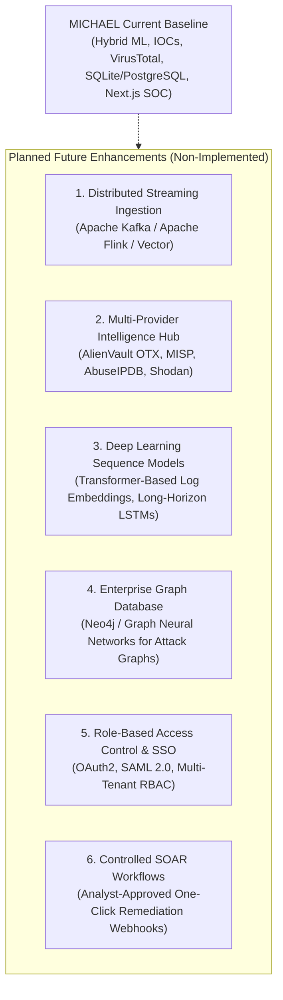

# LIMITATIONS AND FUTURE WORK

**Project:** MICHAEL – THE GUARDIAN AI  
**Academic Title:** Intelligent Log Analysis and Anomaly Detection Using Artificial Intelligence  

---

## 1. Subsystem Limitations

An honest, transparent assessment of operational and architectural boundaries is essential for academic and engineering integrity. The following constraints characterize the current implementation of **MICHAEL – THE GUARDIAN AI**:

### 1.1 Synthetic & Controlled Evaluation Datasets
- **Constraint:** Benchmarks and empirical metrics documented in this research were gathered from strictly partitioned, held-out synthetic test fixtures ($N=190$ detection baseline, $23$ ground-truth IOC scenarios, and multi-tier persistence benchmarks).
- **Impact:** While these datasets were constructed with anti-leakage spatial and temporal separation to evaluate zero-day detection, synthetic logs cannot fully capture the extreme noise, irregular formatting, and proprietary dialect variations encountered in production enterprise datacenters.

### 1.2 External Threat Intelligence Provider Rate Limits
- **Constraint:** Integration with live external threat feeds (specifically public VirusTotal API v3) is constrained by provider-enforced rate limits (e.g., free-tier limits of 4 requests per minute and 500 requests per day).
- **Impact:** In high-volume log ingestion environments containing thousands of unique indicators, free-tier public APIs will encounter HTTP 429 quota exhaustion. While MICHAEL gracefully handles 429 responses and utilizes local TTL caching, production deployment requires commercial multi-provider licenses or local threat intelligence mirrors.

### 1.3 Detection of Ultra "Low-and-Slow" Campaigns
- **Constraint:** The Temporal Behaviour Intelligence Engine currently operates sliding windows spanning horizons up to 300 seconds ($5\text{ minutes}$).
- **Impact:** Adversaries executing deliberate "drip" attacks (e.g., a single failed login attempt every 60 minutes across 30 days) will remain below the rolling Z-score boundary for short windows. Detecting multi-week low-and-slow campaigns requires long-term stateful aggregation across multi-day horizons.

### 1.4 Deliberate Absence of Autonomous Remediation
- **Constraint:** MICHAEL does not autonomously execute destructive containment actions (e.g., dynamically modifying firewall rules, killing system processes, or disabling user accounts).
- **Design Rationale:** This limitation is deliberate and by design. Autonomous remediation in automated systems creates severe operational risks of denial-of-service against legitimate enterprise infrastructure due to false positives. The platform preserves analyst triage sovereignty by providing prescriptive recommendations rather than autonomous intervention.

### 1.5 Threat Intelligence Coverage Gaps
- **Constraint:** External providers maintain intelligence based on historical observations.
- **Impact:** Bespoke malware, private command-and-control servers, and newly registered domains have zero presence in global databases. MICHAEL addresses this via its `UNKNOWN != CLEAN` invariant, but absence of intelligence remains an inherent constraint of external feeds.

---

## 2. Planned Future Enhancements

The following capabilities represent natural extensions of the MICHAEL architecture. These items are **future enhancements and are not implemented in the current baseline**:

### 2.1 Distributed Streaming Architecture
- Integrate Apache Kafka, Apache Flink, or Vector for real-time log streaming at enterprise scale ($>100,000\text{ logs/sec}$), replacing batch file uploads with distributed pub/sub pipelines.

### 2.2 Multi-Provider Threat Intelligence Aggregation
- Expand `ThreatIntelService` to aggregate multiple commercial and open-source intelligence feeds simultaneously (AlienVault OTX, AbuseIPDB, MISP, CrowdStrike Falcon, and local STIX/TAXII servers) with consensus scoring.

### 2.3 Deep Learning Sequence Modeling
- Evaluate deep sequential neural architectures (such as Long Short-Term Memory networks or Transformer log representations like LogBERT) to capture cross-session behavioral semantics spanning weeks.

### 2.4 Enterprise Graph Database Integration
- Transition attack chain and correlation storage from relational JSON columns to a native graph database (such as Neo4j or Amazon Neptune) to enable complex cypher queries and sub-graph pattern matching.

### 2.5 Enterprise Identity & Multi-Tenancy (RBAC)
- Implement OAuth2 / OIDC authentication with Role-Based Access Control (RBAC), segregating SOC analyst permissions (Tier 1 Triage, Tier 2 Investigation, Tier 3 Lead, System Administrator).

### 2.6 Controlled SOAR Integration
- Implement an analyst-approved "One-Click Remediation" webhook system that executes firewall block rules or endpoint isolation only after explicit confirmation by a authenticated SOC analyst.

