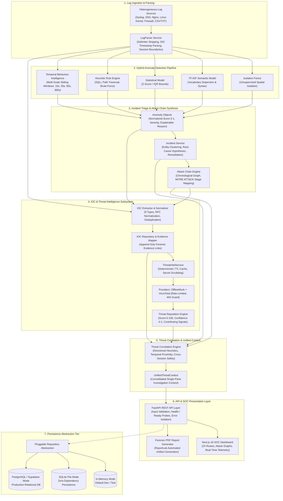

# SYSTEM ARCHITECTURE

**Project:** MICHAEL – THE GUARDIAN AI  
**Academic Title:** Intelligent Log Analysis and Anomaly Detection Using Artificial Intelligence  
**Tagline:** *“Intelligence That Watches. AI That Protects.”*  

---

## 1. High-Level Architecture Topology

MICHAEL is architected as a modular, decoupled platform composed of an asynchronous FastAPI backend service, an integrated Machine Learning and Threat Intelligence processing pipeline, a pluggable multi-backend persistence abstraction, and a responsive Next.js Security Operations Center (SOC) dashboard.

---

## 2. Layered Architectural Decomposition

### Layer 1: Ingestion & Normalization Tier
- **Input Formats:** Syslog (RFC 3164 / RFC 5424), Nginx Combined, SSH Authentication, Linux Kernel (`iptables`, `systemd`, `sudo`), and delimited CSV/TXT.
- **LogParser Service:** Performs line-by-line lexical extraction, ISO 8601 UTC timestamp standardisation, log level classification (`DEBUG`, `INFO`, `WARNING`, `ERROR`, `CRITICAL`), and raw line preservation.
- **Session Boundaries:** Enforces logical separation of datasets into `LogSession` records, enabling tenant isolation and multi-run analysis.

### Layer 2: Hybrid Detection Pipeline
The detection engine operates four concurrent analytical models, complemented by temporal sliding-window metrics:
1. **Isolation Forest:** Evaluates message length, numerical character density, and token entropy to isolate rare structural patterns.
2. **TF-IDF Semantic Dispersion:** Constructs a bag-of-words representation of log messages, flagging tokens with high inverse document frequency (unusual commands, encoded payloads).
3. **Statistical Z-Score:** Computes volumetric and rate outliers across normalized feature distributions.
4. **Deterministic Heuristic Rules:** Captures known signatures including SQL injection (`UNION SELECT`), path traversal (`../etc/passwd`), and authentication brute force.
5. **Temporal Sliding Windows:** Tracks rolling statistics across $10\text{s}$, $30\text{s}$, $60\text{s}$, and $300\text{s}$ horizons, capturing rate-of-change and burst anomalies.

### Layer 3: Incident Derivation & Attack Chain Engine
- **Incident Synthesis:** Clusters concurrent anomalies occurring on shared entities (e.g., hostnames, IPs, user accounts) within dynamic time windows. Produces categorized `Incident` entities complete with severity, potential impact, and remediation recommendations.
- **Attack Chain Reconstruction:** Correlates incidents into multi-stage graphs mapped to the MITRE ATT&CK framework (Reconnaissance $\rightarrow$ Initial Access $\rightarrow$ Execution $\rightarrow$ Persistence $\rightarrow$ C2).

### Layer 4: Indicator of Compromise (IOC) Subsystem
- **Extraction & Normalization:** Extracts 9 indicator categories. Enforces strict canonical formats (e.g., stripping IPv4 leading zeros, lowercasing domains and hashes, stripping default web ports).
- **Forensic Evidence Mapping:** Implements `IOCEvidenceMapper`, which records exact event IDs, session IDs, timestamps, and line numbers where indicators appeared.
- **Analyst Lifecycle Sovereignty:** Distinguishes internal validation (`VALID`, `INVALID`, `SUSPICIOUS`) from external threat status (`CLEAN`, `SUSPICIOUS`, `MALICIOUS`, `UNKNOWN`) and analyst workflow triage (`EXTRACTED`, `UNDER_REVIEW`, `CONFIRMED`, `FALSE_POSITIVE`). Automated pipelines are prohibited from mutating analyst workflow states.

### Layer 5: Threat Intelligence & Reputation Engine
- **Provider Architecture:** Employs an abstract `ThreatIntelProvider` interface. Implements `OfflineMockThreatIntelProvider` for deterministic, zero-socket environments and `VirusTotalProvider` for live external lookups.
- **Threat Reputation Engine:** Evaluates structured intelligence signals to compute a deterministic Threat Score ($0–100$) and an independent Confidence Score ($0–1$).
- **Telemetry Deficit Protection:** Enforces that HTTP 404 responses from external providers map strictly to `UNKNOWN`, preventing false-safe assumptions.

### Layer 6: Threat Correlation & Unified Context
- **Correlation Engine:** Forms directional evidence relationships across IOCs, raw log events, anomalies, incidents, and attack chains.
- **Confidence Computation:** Scores link credibility based on direct explicit references, shared event IDs, and calibrated temporal windows ($\le 30\text{s}$, $30\text{s}–5\text{m}$, $5\text{m}–15\text{m}$).
- **Cross-Session Safeguards:** Applies a $0.40$ penalty multiplier and forces `confirmed = False` on cross-session links to prevent speculative cross-tenant correlation.
- **UnifiedThreatContext:** Assembles a consolidated investigation context providing single-pane visibility across all linked security objects.

### Layer 7: Persistence & Storage Tier
- **Pluggable Abstraction:** Utilizes an abstract repository pattern configured via `PERSISTENCE_BACKEND` (`memory`, `sqlite`, `postgres`).
- **12-Table Relational Schema:** Enforces foreign-key integrity, timezone-aware UTC timestamps, range constraints, and indexing across all platform entities.

---

## 3. Technology Stack Reference

| Component | Technology | Version / Specification | Rationale |
|---|---|---|---|
| **Backend Framework** | Python / FastAPI | Python 3.12+ / FastAPI 0.115+ | High-performance asynchronous REST API, native Pydantic schema validation. |
| **Machine Learning** | Scikit-learn / NumPy | Scikit-learn 1.5+ | Efficient, industry-standard Isolation Forest and TF-IDF implementations. |
| **Data Validation** | Pydantic v2 | Pydantic 2.10+ | Strict type enforcement, runtime validation, and JSON serialization. |
| **Persistence / ORM** | SQLAlchemy | SQLAlchemy 2.0+ | Pluggable SQL toolkit supporting SQLite and PostgreSQL / Supabase dialects. |
| **PDF Reporting** | ReportLab | ReportLab 4.2+ | Programmatic, high-fidelity PDF generation for forensic compliance. |
| **Frontend Framework** | Next.js / React | Next.js 16 (App Router) / React 19 | High-performance server-side rendering, static site generation, and modular UI. |
| **Styling & Icons** | Tailwind CSS / Lucide | Tailwind 3.4+ / Lucide React | Modern responsive design system tailored for high-density SOC data display. |
| **Testing Harness** | Python `unittest` | Python Standard Library | Zero-dependency, deterministic test discovery, regression, and benchmarking. |

