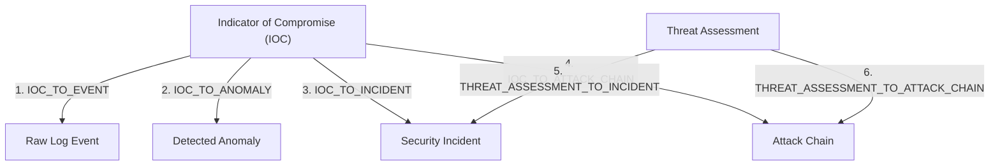

# THREAT CORRELATION & UNIFIED INTELLIGENCE ENGINE

**Project:** MICHAEL – THE GUARDIAN AI  
**Academic Title:** Intelligent Log Analysis and Anomaly Detection Using Artificial Intelligence  

---

## 1. Core Design Principle: Correlation is NOT Classification

A foundational rule of **MICHAEL – THE GUARDIAN AI** is the absolute separation of relationship discovery from classification:

$$\text{Correlation} \ne \text{Classification}$$

```text
IOC appears in an Incident      ≠      IOC is confirmed Malicious
IOC has a Malicious Score       ≠      Every Incident containing it is Critical
Temporal Proximity              ≠      Causal Relationship
```

Automated correlation is strictly **additive and non-destructive**:
- It adds evidence bullets explaining *why* two objects are related.
- It computes a directional correlation confidence score.
- It links identifiers into a unified investigation graph.
- **It NEVER mutates** `IOCStatus`, `ThreatIntelStatus`, `Incident.severity`, `Incident.status`, or `AttackChain.status`.

Analyst sovereignty is maintained at all times.

---

## 2. Six Directional Relationship Models

The `ThreatCorrelationEngine` derives six distinct relationship types:



### 1. `IOC_TO_EVENT`
- **Method:** Line-number corroborated lexical appearance.
- **Evidence:** References exact `event_id`, session, and timestamp where the indicator string was extracted.
- **Confidence:** High ($1.0$ for exact line matches).

### 2. `IOC_TO_ANOMALY`
- **Method:** Evaluated via three hierarchical heuristics:
  1. *Explicit link:* Anomaly metadata explicitly lists the IOC ID.
  2. *Shared event:* Anomaly's `log_entry_ids` contains the event where the IOC was observed.
  3. *Temporal proximity:* Anomaly occurred within calibrated time windows of the IOC observation.

### 3. `IOC_TO_INCIDENT`
- **Method:** Evaluated via explicit references, linked anomaly chains, or entity containment (indicator appears in `affected_ips`).

### 4. `IOC_TO_ATTACK_CHAIN`
- **Method:** Evaluated via shared incident links or appearance in chain-link events.

### 5. `THREAT_ASSESSMENT_TO_INCIDENT`
- **Method:** Bridges external intelligence verdict (e.g., Cobalt Strike C2, Threat Score $85.0$) directly to the incident containing the indicator.

### 6. `THREAT_ASSESSMENT_TO_ATTACK_CHAIN`
- **Method:** Enriches multi-stage attack progressions with external threat categorization, mapping attacker infrastructure to MITRE techniques.

---

## 3. Calibrated Temporal Correlation Windows

When linking IOCs to anomalies without an explicit shared event ID, the engine enforces strict temporal window boundaries:

| Window Tier | Delta Threshold ($\Delta t$) | Base Score | Confirmed State | Operational Classification |
|---|---|---|---|---|
| **Immediate** | $\Delta t \le 30\text{s}$ | $0.40$ | `True` | Direct temporal clustering; highly probable relationship. |
| **Short** | $30\text{s} < \Delta t \le 300\text{s}$ ($5\text{m}$) | $0.30$ | `False` | Loose temporal proximity; marked unconfirmed. |
| **Extended** | $300\text{s} < \Delta t \le 900\text{s}$ ($15\text{m}$) | $0.20$ | `False` | Speculative correlation; marked unconfirmed. |
| **Out-of-Window** | $\Delta t > 900\text{s}$ ($15\text{m}$) | $0.00$ | **Rejected** | **No correlation generated** (prevents temporal drift). |

---

## 4. Cross-Session Safety & Tenant Segregation

In multi-session environments (e.g., investigating different servers or distinct time intervals), indicators observed in Session B may match incidents in Session A.

To prevent speculative cross-tenant contamination:
1. **Unconfirmed Status:** All cross-session correlations enforce `confirmed = False`.
2. **Penalty Multiplier:** The raw confidence score is penalized by multiplying by `CROSS_SESSION_PENALTY_MULTIPLIER` ($0.40$), clamped to a maximum score of $0.35$.
3. **Explicit Annotations:** Evidence bullets explicitly warn:
   `"Cross-session relationship across sessions remains UNCONFIRMED (Session '...')."`

---

## 5. The Unified Threat Context (`UnifiedThreatContext`)

The culmination of the correlation engine is the assembly of the `UnifiedThreatContext`, providing analysts with a complete, structured view of an indicator's operational footprint:

```python
class UnifiedThreatContext(BaseModel):
    ioc_id: str
    ioc_value: str
    normalized_value: str
    ioc_type: IOCType
    analyst_status: IOCStatus
    threat_intel_result: Optional[ThreatIntelResult]
    threat_assessment: Optional[ThreatAssessment]
    related_events: List[Dict[str, Any]]
    related_anomalies: List[Dict[str, Any]]
    related_incidents: List[Dict[str, Any]]
    related_attack_chains: List[Dict[str, Any]]
    correlations: List[ThreatCorrelation]
    overall_correlation_confidence: float
    investigation_summary: Dict[str, Any]
    generated_at: datetime
```

### Investigation Summary Metrics:
- Total correlation count
- Confirmed vs. Unconfirmed breakdown
- Unique linked events, anomalies, incidents, and chains
- Highest observed correlation confidence tier (`LOW`, `MEDIUM`, `HIGH`)
- Human-readable key findings narrative

