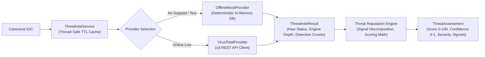

# THREAT INTELLIGENCE & REPUTATION ENGINE

**Project:** MICHAEL – THE GUARDIAN AI  
**Academic Title:** Intelligent Log Analysis and Anomaly Detection Using Artificial Intelligence  

---

## 1. Subsystem Architecture

The Threat Intelligence Subsystem enriches extracted indicators with external and offline intelligence telemetry, evaluates confidence, calculates deterministic reputation scores, and decomposes scores into explainable contributing signals.



---

## 2. Pluggable Provider Abstraction (`ThreatIntelProvider`)

All intelligence sources implement the base abstract interface:

```python
class ThreatIntelProvider(ABC):
    @property
    @abstractmethod
    def provider_name(self) -> str:
        """Machine identifier (e.g., 'offline_mock', 'virustotal')."""
        pass

    @property
    @abstractmethod
    def is_available(self) -> bool:
        """Returns True if provider has valid credentials and connectivity."""
        pass

    @abstractmethod
    def lookup(self, ioc: IOC) -> ThreatIntelResult:
        """Synchronous threat intelligence lookup."""
        pass

    @abstractmethod
    async def lookup_async(self, ioc: IOC) -> ThreatIntelResult:
        """Asynchronous threat intelligence lookup."""
        pass
```

### 2.1 Offline Mock Provider (`OfflineMockThreatIntelProvider`)
- **Purpose:** Enables fully functional, deterministic, zero-network threat intelligence lookups for testing, academic demonstration, and air-gapped environments.
- **Implementation:** Maintains an in-memory dictionary of ground-truth threat signatures mapped to known C2 IPs, malicious domains, and attack hashes.
- **Zero-Network Guarantee:** Enforces that zero TCP or UDP network sockets are opened during operation.

### 2.2 VirusTotal Provider (`VirusTotalProvider`)
- **Purpose:** Connects to the commercial VirusTotal v3 public REST API for live global threat telemetry.
- **Endpoints:**
  - IPv4/IPv6: `https://www.virustotal.com/api/v3/ip_addresses/{ip}`
  - Domain: `https://www.virustotal.com/api/v3/domains/{domain}`
  - File Hashes (MD5/SHA1/SHA256): `https://www.virustotal.com/api/v3/files/{hash}`
  - URLs: `https://www.virustotal.com/api/v3/urls/{id}`
- **Authentication:** `x-apikey` HTTP header loaded from the `VIRUSTOTAL_API_KEY` environment variable.

---

## 3. Failure Handling & HTTP Status Code Mapping

The VirusTotal provider implements defensive error handling:

| HTTP Status | ThreatIntelStatus | Engine Action | Security Invariant |
|---|---|---|---|
| **200 OK** | `MALICIOUS` / `SUSPICIOUS` / `CLEAN` | Parse engine detection ratios and tags. | Standard operational state. |
| **401 Unauthorized** | `ThreatIntelStatus.ERROR` | Log warning; disable provider; fall back to offline. | API key scrubbed from log outputs. |
| **403 Forbidden** | `ThreatIntelStatus.ERROR` | Log permission restriction. | No exception raised to client. |
| **404 Not Found** | `ThreatIntelStatus.UNKNOWN` | Map to `UNKNOWN` with 0 score and 0 confidence. | **CRITICAL: 404 is NEVER mapped to CLEAN.** |
| **429 Rate Limit** | `ThreatIntelStatus.ERROR` | Parse `Retry-After` header; record rate-limit backoff. | Prevents API ban. |
| **500 / 502 / 503** | `ThreatIntelStatus.ERROR` | Gracefully return error status without crashing pipeline. | Upstream server resilience. |
| **Timeout / Malformed** | `ThreatIntelStatus.ERROR` | Catch connection timeout; fallback gracefully. | Pipeline continuity. |

---

## 4. The Critical Invariant: `UNKNOWN != CLEAN`

A fundamental flaw in naive threat intelligence implementations is misinterpreting an external provider's `404 Not Found` response as a declaration that the indicator is safe.

```text
404 Not Found ──▶ "No threat intelligence found on this IP"
                             ≠
                  "This IP is confirmed benign"
```

In cybersecurity operations, zero-day threat infrastructure, newly generated domain algorithms (DGAs), and bespoke bulletproof hosting IPs have **zero historical telemetry** in external databases. Coercing a `404` to `CLEAN` creates catastrophic blind spots.

MICHAEL strictly enforces:
$$\text{HTTP } 404 \implies \text{ThreatIntelStatus.UNKNOWN}$$
$$\text{ThreatIntelStatus.UNKNOWN} \implies \text{ThreatScore} = 0.0, \quad \text{Confidence} = 0.0, \quad \text{Severity} = \text{UNKNOWN}$$

---

## 5. Decoupled Scoring: Threat Score vs. Threat Confidence

MICHAEL maintains that **Threat Score and Threat Confidence are fundamentally separate concepts**:

```text
┌──────────────────────────────────────┐  ┌──────────────────────────────────────┐
│             THREAT SCORE             │  │          THREAT CONFIDENCE           │
│             (0.0 – 100.0)            │  │             (0.0 – 1.0)              │
├──────────────────────────────────────┤  ├──────────────────────────────────────┤
│ Measures the MAGNITUDE of malicious  │  │ Measures the CERTAINTY and DEPTH of  │
│ behavior indicated by available data.│  │ the supporting telemetry source.     │
└──────────────────────────────────────┘  └──────────────────────────────────────┘
```

### Scenario Comparison Demonstrating Decoupling:

1. **Scenario A (Single Engine Malicious Detection):**
   - 1 out of 2 scanned engines flags an IP as Cobalt Strike C2.
   - $\text{Threat Score} = 75.0$ (High threat potential).
   - $\text{Confidence} = 0.25$ (Low confidence due to low engine coverage, total engines $< 50$).
   - *Outcome:* The analyst is warned of potential high severity, but informed that corroborating evidence is scarce.

2. **Scenario B (Overwhelming Engine Consensus Benign):**
   - 0 out of 72 engines flag the IP (e.g., `8.8.8.8` Google DNS).
   - $\text{Threat Score} = 0.0$ (Clean).
   - $\text{Confidence} = 0.95$ (Extremely high confidence due to massive engine coverage).

### 5.1 Threat Score Formula
$$\text{ThreatScore} = \min\left(100.0, \quad \text{BaseScore}(\text{Status}) + \sum_{i} \text{SignalPoints}_i\right)$$

### 5.2 Threat Confidence Formula
$$\text{Confidence} = \text{clamp}\left(C_{\text{base}} \times \left(\frac{\text{EnginesTotal}}{\text{MaxEngineThreshold}}\right) + C_{\text{vendor\_reputation}}, \quad 0.0, \quad 1.0\right)$$

---

## 6. Secret Scrubbing & Data Protection

All credentials (including the `VIRUSTOTAL_API_KEY`) are protected by recursive sanitization:
- The `VirusTotalProvider` masks keys in memory (`mock_test_key` $\to$ `mo********ey`).
- Error messages, logs, and HTTP JSON payloads undergo recursive regex replacement, redacting patterns matching `api_key`, `token`, `password`, `bearer`, or `auth`.
- Serialization tests in the security audit verified zero occurrences of raw keys in API responses.

