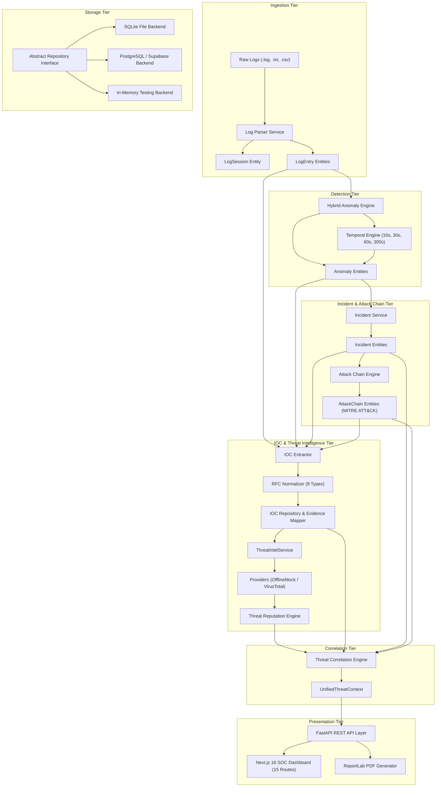

# CHAPTER 10: SYSTEM DESIGN & ARCHITECTURE

## 8.1 Architectural Design Principles
The design of **MICHAEL – THE GUARDIAN AI** adheres to four core principles:
1. **Separation of Concerns:** Business logic, machine learning detection, intelligence lookups, and storage persistence reside in distinct, loosely coupled layers.
2. **Defensive Non-Destructive Operation:** Correlation and analysis engines act as additive evidence providers; source entities remain bitwise immutable.
3. **Forensic Traceability:** Every higher-level detection (anomaly, incident, attack chain, IOC) maintains an unbroken reference back to exact source log line numbers.
4. **Pluggability:** Storage backends (Memory, SQLite, PostgreSQL) and threat intelligence providers (OfflineMock, VirusTotal) implement standard interfaces and can be swapped via configuration flags.

## 8.2 Component Hierarchy & Data Flow

## 8.3 Entity Relationship Model (12-Table Schema)
The physical database design enforces relational constraints across twelve tables:
- `sessions`: Session tracking, line counts, and upload timestamps.
- `events`: Individual parsed log lines with exact line numbers and timestamps.
- `anomalies`: Anomaly detections with scores, severities, and method tags.
- `model_metrics`: Session-level ML accuracy and contamination parameters.
- `incidents`: Aggregated incidents with impact analyses and remediation guidance.
- `attack_chains`: Multi-stage attack progression graphs with MITRE ATT&CK stages.
- `iocs`: Canonical indicators deduplicated by `(ioc_type, normalized_value)`.
- `ioc_evidence`: Append-only forensic evidence links mapping IOCs to events.
- `threat_intel_results`: Cached external provider query outcomes.
- `threat_assessments`: Deterministic threat reputation scores and contributing signals.
- `threat_correlations`: Directional links connecting security objects.
- `audit_records`: Immutable log of human analyst triage actions.

